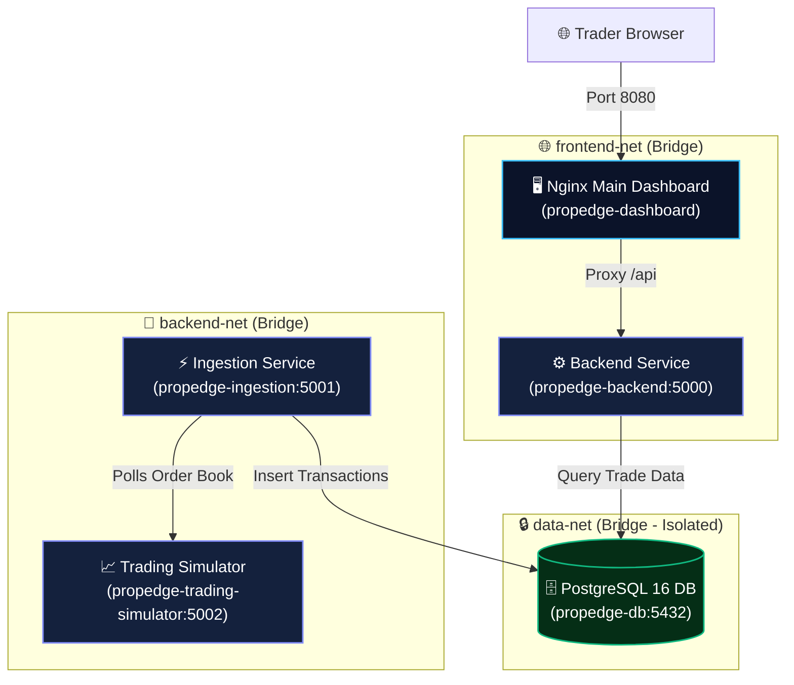

<div align="center">

# ⚡ PropEdge Trading Platform Lab

### High-Concurrency Containerized Proprietary Trading System Architecture

<p align="center">
  
  
  
  
  
</p>

</div>

---

## 📌 Executive Overview

**PropEdge** is a multi-tier containerized simulated proprietary trading platform engineered to demonstrate:
- **Segregated Docker Bridge Networks:** Independent internal network tiers preventing direct external access to databases and ingestion engines.
- **Service-to-Service DNS Resolution:** Container orchestration without hardcoded IP dependencies.
- **High-Frequency Ingestion & State Persistence:** Automated trade ingestion pipeline feeding a transactional PostgreSQL database with named volume persistence.
- **Reverse Proxy Architecture:** Nginx edge proxy directing client traffic to frontend dashboards and authenticated backend APIs.
- **Cloudflare Tunnel Ingress Ready:** Hardened zero-trust edge ingress avoiding open incoming firewall ports.

---

## 🏗️ Multi-Tier Architecture & Network Isolation



---

## 🧰 Microservice Architecture

| Service Directory | Container Name | Stack & Runtime | Internal Port | Network Attachments | Responsibility |
| :--- | :--- | :--- | :---: | :--- | :--- |
| `01-main-dashboard` | `propedge-dashboard` | Nginx Alpine | `80` (Host `8080`) | `frontend-net` | Trader portal UI, static assets, reverse proxy |
| `02-backend-service` | `propedge-backend` | Python 3.12, psycopg2 | `5000` | `frontend-net`, `data-net` | Authentication, REST API endpoints, business logic |
| `03-trading-simulator` | `propedge-trading-simulator` | Python 3.12 | `5002` (Host `5002`) | `backend-net`, `data-net` | Market simulation engine, randomized order book |
| `04-ingestion-service` | `propedge-ingestion` | Python 3.12 | `5001` | `backend-net`, `data-net` | Polling worker ingesting simulated trades into DB |
| `05-database` | `propedge-db` | PostgreSQL 16 Alpine | `5432` | `data-net` | Schema migrations, transaction seed data, named volume |

---

## 🚀 Quickstart & Orchestration

### 1. Launch Complete Stack

```bash
# Clone and spin up all microservices with parallel build
git clone https://github.com/sanjiivsingh/PropEdge-Docker-Lab.git
cd PropEdge-Docker-Lab

docker compose -f compose.yaml up -d --build
```

### 2. Verify Service Health

```bash
# Check container status and healthchecks
docker compose -f compose.yaml ps

# Inspect live ingestion logs
docker compose -f compose.yaml logs -f ingestion
```

### 3. Access Trader Portal

* **Trader Dashboard:** Open `http://localhost:8080`
* **Demo Credentials:**
  ```text
  Username: trader
  Password: trader123
  ```
* **Simulator Direct API:** `http://localhost:5002`

---

## 🛡️ Security & Zero-Trust Best Practices

1. **Network Demarcation:** The `propedge-db` database is exclusively connected to `data-net`. It exposes **zero ports** to the host machine or public internet.
2. **Health Check Orchestration:** Backend and Ingestion services utilize `condition: service_healthy` depending on PostgreSQL's `pg_isready` probe before starting.
3. **Graceful Degradation:** All services run with automatic container restarts (`restart: unless-stopped`).
4. **Volume Persistence:** Data is retained safely across container updates in named volume `postgres_data`.

---

## 📄 License

MIT License - open for educational and enterprise architectural demonstration.
